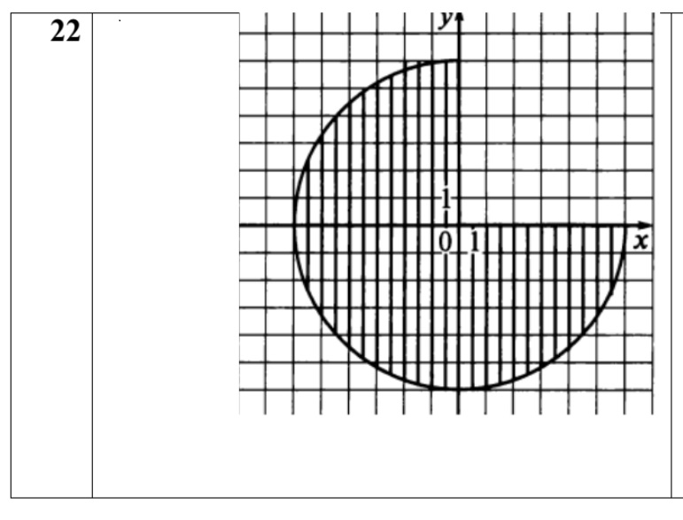
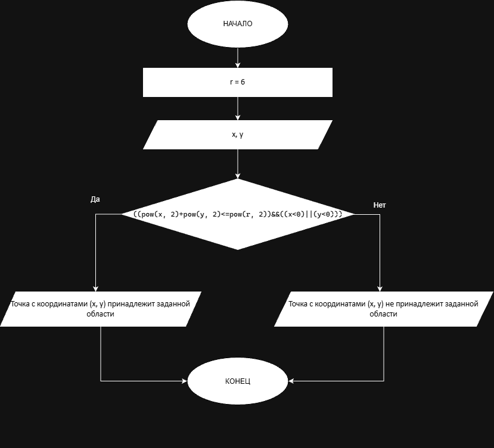

# Домашнее задание к работе 6
## Условие задачи
Составить программу, которая проверяет принадлежит ли заданная пользователем точка с
координатами (х, у) заданным закрашенным (заштрихованным) областям, показанным на рисунках
в табл., и выводит на экран сообщение.

## 1.Алгоритм и блок-схема
1. **НАЧАЛО**
2. объявление константы r = 6
3. получение х, у
4. проверка условия ((pow(x, 2)+pow(y, 2)<=pow(r, 2))&&((x<0)||(y<0)))
5. вывод сообщения с результатом
### Блок-схема

## 2.Реализация программы
{
	#include <stdio.h>
	#include <math.h>
	#include <locale.h>
	main()
	{

		setlocale(LC_CTYPE, "RUS");
		double x;
		double y;
		int r = 6; 
		printf("Введите через запятую координаты точки (x, y)\n");
		scanf("%lf,%lf", &x, &y);
		if ((pow(x, 2)+pow(y, 2)<=pow(r, 2))&&((x<0)||(y<0)))
			printf("Точка с координатами (%.1lf,%.1lf) принадлежит заданной области", x, y);
		else printf("Точка с координатами (%.1lf,%.1lf) не принадлежит заданной области", x, y);
	

	}
}

## 3.Результат выполнения программы
Введите через запятую координаты точки (x, y)
-1,2
Точка с координатами (-1.0,2.0) принадлежит заданной области
C:\Users\tihon\source\repos\dzlab6\x64\Debug\dzlab6.exe (процесс 7500) завершил работу с кодом 0 (0x0).

Введите через запятую координаты точки (x, y)
1,1
Точка с координатами (1.0,1.0) не принадлежит заданной области
C:\Users\tihon\source\repos\dzlab6\x64\Debug\dzlab6.exe (процесс 9128) завершил работу с кодом 0 (0x0).
## 4.Информация об авторе
Савченко Тихон бИЦТ-261
