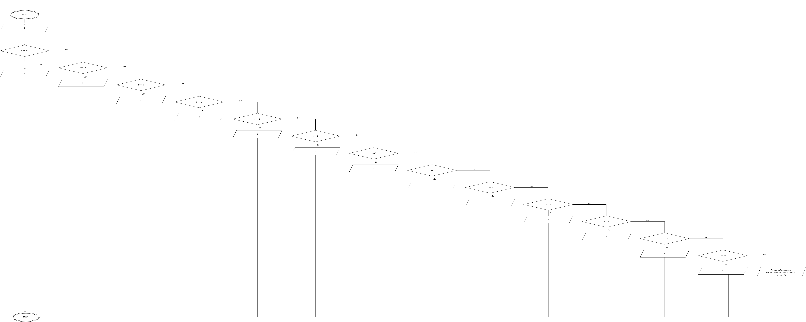

# Домашнее задание к работе 6
## Условие задачи
Составить программу, которая интерпретирует степени 10 в
соответствующие приставки вида «пико», «нано» ... «тера».
## 1.Алгоритм
1.**НАЧАЛО**

2.Получение s

3.Интерпритация s

4.Форматированный вывод результата
### Блок-схема

## 2.Реализация программы
#include <stdio.h>
#include <locale.h>

main()
{
	setlocale(LC_CTYPE, "RUS");
	int s;
	printf("Введите целую степень\n 10^");
	scanf("%d", &s);
	switch (s)
	{
	case -12:
		printf("Множителю 10^%d соответствует приставка пико", s);
		break;
	case -9:
		printf("Множителю 10^%d соответствует приставка нано", s);
		break;
	case -6:
		printf("Множителю 10^%d соответствует приставка микро", s);
		break;
	case -3:
		printf("Множителю 10^%d соответствует приставка милли", s);
		break;
	case -1:
		printf("Множителю 10^%d соответствует приставка деци", s);
		break;
	case -2:
		printf("Множителю 10^%d соответствует приставка санти", s);
		break;
	case 1:
		printf("Множителю 10^%d соответствует приставка дека", s);
		break;
	case 2:
		printf("Множителю 10^%d соответствует приставка гекто", s);
		break;
	case 3:
		printf("Множителю 10^%d соответствует приставка кило", s);
		break;
	case 6:
		printf("Множителю 10^%d соответствует приставка мега", s);
		break;
	case 9:
		printf("Множителю 10^%d соответствует приставка гига", s);
		break;
	case 12:
		printf("Множителю 10^%d соответствует приставка тера", s);
		break;
	case 15:
		printf("Множителю 10^%d соответствует приставка пета", s);
		break;
	default:
		printf("Введенной степени не соответствует ни одна приставка системы СИ");
		break;

	}
}
## 3.Результат выполнения программы
Введите целую степень
 10^3
Множителю 10^3 соответствует приставка кило
C:\Users\tihon\source\repos\dzlab7\x64\Debug\dzlab7.exe (процесс 7172) завершил работу с кодом 0 (0x0).
## 4.Информация об авторе
Савченко Тихон бИЦТ-261
